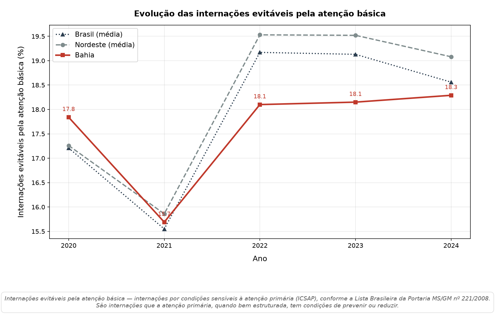

# Internações Evitáveis pela Atenção Básica — Bahia vs Nordeste (2020–2024)

Análise de **57,4 milhões de internações** do SIH/SUS para medir a taxa de
ICSAP (Internações por Condições Sensíveis à Atenção Primária) na Bahia,
comparada ao Nordeste e ao Brasil.

## Resultado principal

A Bahia empata com o Nordeste na taxa global — **18,29% vs 19,08% em 2024** —
mas essa igualdade esconde movimentos opostos dentro dos grupos de causa.



A Bahia vai **pior** em doenças crônicas e nutricionais (deficiências
nutricionais +146%, asma +68%) e **melhor** em doenças infecciosas agudas
(gastroenterites −38%, pneumonias −22%).

**A leitura:** a atenção básica baiana funciona bem no episódico e falha no
continuado. Doença infecciosa é tratada; doença crônica não é acompanhada.

## O que o projeto faz

- Baixa e processa 1.140 arquivos Parquet do DATASUS (57,4 milhões de registros)
- Classifica cada internação pela Lista Brasileira de ICSAP (Portaria MS/GM nº 221/2008)
- Compara Bahia, Nordeste e Brasil por ano, UF e grupo de causa
- Gera relatório em Markdown com 5 quadros e 3 figuras

## Stack

Python 3.11 · pandas · matplotlib · pytest

## Estrutura

```text
src/icsap/
├── config.py                 # caminhos e constantes
├── sih.py                    # download dos arquivos do DATASUS
├── limpeza.py                # normalização dos campos
├── classificacao_icsap.py    # classificação pela lista ICSAP
├── analise.py                # carga e preparação da base
├── comparacao_regional.py    # BA vs NE vs Brasil
├── comparacao_grupos.py      # comparação por grupo de causa
├── exportar.py               # saída em CSV/Parquet
├── rotulos.py                # rótulos e legendas
├── grafico_comparacao.py     # Figura 1
├── grafico_convergencia.py   # Figura 2
├── grafico_grupos.py         # Figura 3
├── relatorio.py              # montagem do relatório
└── pipeline.py               # orquestrador