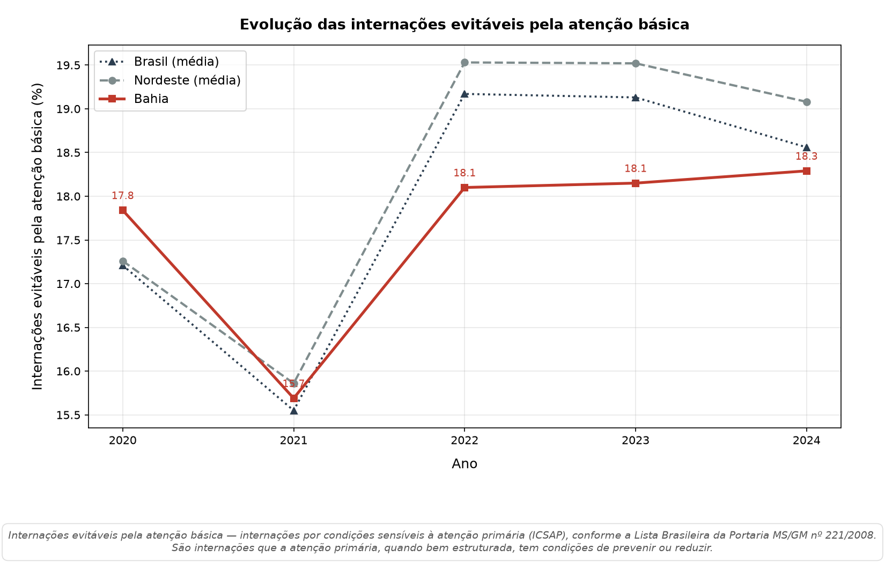
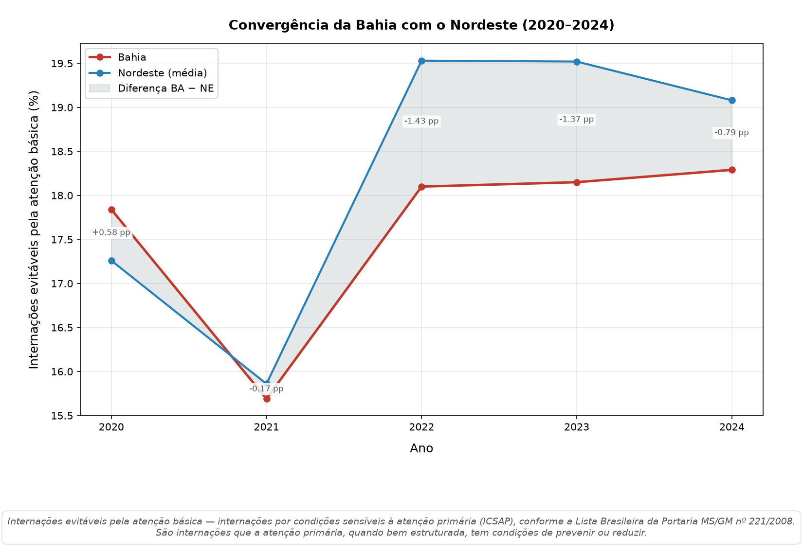
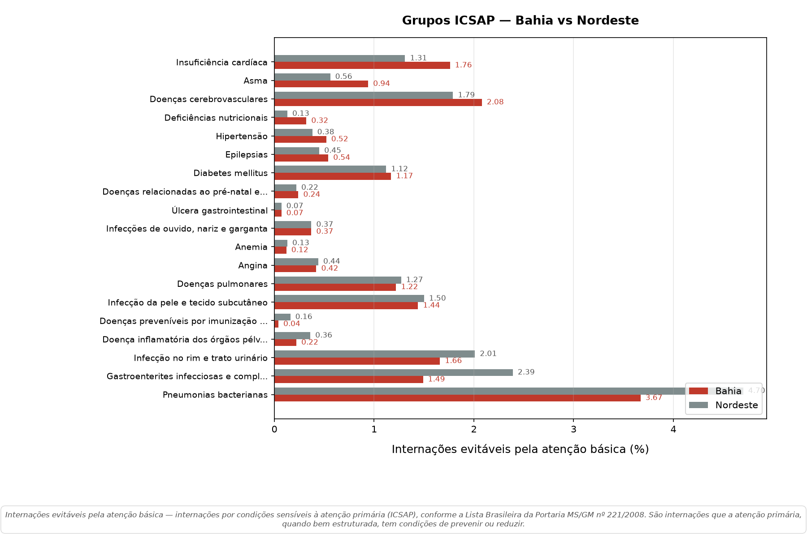

# Internações evitáveis pela atenção básica

**Bahia vs Nordeste e Brasil — 2020 a 2024**

Gerado em 24/11/2026 às 20:06

---

## Panorama

Período analisado: **2020 a 2024**. Escopos: Bahia, média do Nordeste e média nacional.

A taxa da Bahia foi de **17,84%** em 2020 para **18,29%** em 2024 — uma variação de **0,45 ponto percentual** em cinco anos.

Na prática, a Bahia está no mesmo patamar de 2020. O ano de 2021 (15,69%) é atípico: a pandemia reduziu o volume geral de internações e não deve ser lido como melhoria real da atenção básica.

Contra o Nordeste, a Bahia convergiu: estava **3,4%** acima da média regional em 2020 e ficou em **-4,1%** em 2024.

## Principais achados

A Bahia empata com o Nordeste na taxa global, mas essa igualdade esconde movimentos opostos dentro dos grupos.

- **A BA vai pior em doenças crônicas e nutricionais.** Os grupos que mais puxam a taxa para cima são **Insuficiência cardíaca** (34,4%), **Asma** (67,9%), **Doenças cerebrovasculares** (16,2%), **Deficiências nutricionais** (146,2%). São condições que exigem acompanhamento continuado — consulta periódica, adesão a medicamento, visita domiciliar.
- **A BA vai melhor em doenças infecciosas agudas e prevenção.** Os grupos com maior vantagem são **Pneumonias bacterianas** (-21,9%), **Gastroenterites infecciosas e complicações** (-37,7%), **Infecção no rim e trato urinário** (-17,4%). São condições que respondem a ações pontuais — vacinação, saneamento, atendimento de urgência.
- **A leitura central:** a atenção básica da Bahia funciona bem no episódico e falha no continuado. Doenças infecciosas são resolvidas; doenças crônicas não são acompanhadas.
- **O caso mais grave são as deficiências nutricionais**, porque atingem criança — e criança desnutrida vira adulto com doença crônica. É onde o retorno do investimento é maior.

## Casos contraintuitivos no ranking

**AL** (12,43%) e **RN** (13,27%) apresentam as menores taxas de ICSAP do ranking, abaixo de estados com estrutura hospitalar mais consolidada como SP, SC e PR. O achado é contraintuitivo e não deve ser lido automaticamente como melhor desempenho da atenção básica.

Duas explicações concorrem: (a) atenção primária efetivamente mais resolutiva, que evita a internação antes que ela aconteça; (b) sub-registro de ICSAP na AIH, que reclassifica internações evitáveis como outras causas e reduz artificialmente a taxa.

### Internações por mil habitantes

O volume de internações por mil habitantes ajuda a separar as duas hipóteses. Taxa baixa com volume baixo sugere sub-registro; taxa baixa com volume normal sugere desempenho real.

**Quadro 3** — Internações por mil habitantes e taxa de ICSAP. Alagoas, Rio Grande do Norte, Bahia e Maranhão, 2024.

| UF | Internações | População (2024) | Por mil hab. | Taxa ICSAP |
|---|---|---|---|---|
| AL | 176.348 | 3.220.104 | 54,8 | 12,43% |
| RN | 215.993 | 3.446.072 | 62,7 | 13,27% |
| BA | 952.202 | 14.850.513 | 64,1 | 18,29% |
| MA | 506.442 | 7.010.960 | 72,2 | 25,54% |

*Fonte: SIH/SUS e estimativas populacionais IBGE, 2024. Elaboração própria.*

**Alagoas** registra o menor volume do ranking. Taxa baixa combinada com volume baixo é o padrão compatível com sub-registro.

**Rio Grande do Norte** registra volume próximo da média nacional. Aqui a hipótese de sub-registro enfraquece: a taxa baixa sugere desempenho real da atenção básica ou perfil de morbidade distinto.

**Bahia** fica no meio: volume próximo da média nacional e taxa intermediária. É o padrão de um estado que interna no ritmo esperado e converte parte disso em internações evitáveis — nem sub-registro, nem desempenho excepcional.

**Maranhão** é o contraponto: interna muito e interna mal, o oposto do padrão alagoano. A comparação entre os quatro estados mostra que taxa baixa pode significar coisas diferentes conforme o volume.

A verificação definitiva exige auditar a codificação do diagnóstico principal na AIH nesses estados — o que está fora do escopo desta análise.

## Evolução anual

**Quadro 1** — Taxa de ICSAP (%) por ano. Bahia, média do Nordeste e média nacional, 2020–2024.

| Ano | Bahia | Nordeste | Brasil |
|---|---|---|---|
| 2020 | 17,84% | 17,26% | 17,21% |
| 2021 | 15,69% | 15,86% | 15,55% |
| 2022 | 18,10% | 19,53% | 19,17% |
| 2023 | 18,15% | 19,52% | 19,13% |
| 2024 | 18,29% | 19,08% | 18,56% |

*Fonte: SIH/SUS, 2020–2024. Elaboração própria.*

**Figura 1** — Evolução da taxa de ICSAP (%). Bahia, Nordeste e Brasil, 2020–2024.

*Fonte: SIH/SUS, 2020–2024. Elaboração própria.*

## Convergência com o Nordeste

A área sombreada mostra a diferença entre a Bahia e a média nordestina. Ela encolhe de 2020 a 2024 — não porque a BA melhorou, mas porque o Nordeste se aproximou do patamar baiano.

**Figura 2** — Convergência da taxa de ICSAP entre Bahia e Nordeste, 2020–2024.

*Fonte: SIH/SUS, 2020–2024. Elaboração própria.*

## Ranking dos estados (2024)

**Quadro 2** — Ranking das unidades federativas por taxa de ICSAP (%), 2024.

| UF | Internações | Evitáveis | Taxa |
|---|---|---|---|
| MA | 506.442 | 129.369 | 25,54% |
| AM | 226.028 | 54.572 | 24,14% |
| PA | 552.180 | 119.512 | 21,64% |
| PI | 213.373 | 45.771 | 21,45% |
| CE | 586.935 | 125.148 | 21,32% |
| MG | 1.560.770 | 317.373 | 20,33% |
| RS | 832.375 | 169.083 | 20,31% |
| PB | 263.758 | 48.956 | 18,56% |
| BA | 952.202 | 174.205 | 18,29% |
| PR | 1.033.753 | 186.372 | 18,03% |
| ES | 307.232 | 54.812 | 17,84% |
| GO | 452.628 | 79.224 | 17,50% |
| SP | 2.838.585 | 479.612 | 16,90% |
| PE | 662.957 | 111.708 | 16,85% |
| SC | 650.894 | 108.929 | 16,74% |
| SE | 118.745 | 19.671 | 16,57% |
| RJ | 902.578 | 149.022 | 16,51% |
| RN | 215.993 | 28.665 | 13,27% |
| AL | 176.348 | 21.918 | 12,43% |

*Fonte: SIH/SUS, 2024. Elaboração própria. Estados com cobertura inferior a 20% do volume mediano foram excluídos.*

## Grupos ICSAP — Bahia vs Nordeste (2024)

**Figura 3** — Taxa de ICSAP por grupo (%). Bahia e Nordeste, 2024.

*Fonte: SIH/SUS, 2020–2024. Elaboração própria.*

### Grupos em que a BA está acima do Nordeste

**Quadro 4** — Taxa de ICSAP por grupo (%). Bahia e Nordeste, 2024.

| Grupo | BA | NE | Diferença | Relativa |
|---|---|---|---|---|
| Insuficiência cardíaca | 1,76% | 1,31% | 0,45 pp | 34,4% |
| Asma | 0,94% | 0,56% | 0,38 pp | 67,9% |
| Doenças cerebrovasculares | 2,08% | 1,79% | 0,29 pp | 16,2% |
| Deficiências nutricionais | 0,32% | 0,13% | 0,19 pp | 146,2% |
| Hipertensão | 0,52% | 0,38% | 0,14 pp | 36,8% |
| Epilepsias | 0,54% | 0,45% | 0,09 pp | 20,0% |
| Diabetes mellitus | 1,17% | 1,12% | 0,05 pp | 4,5% |
| Doenças relacionadas ao pré-natal e parto | 0,24% | 0,22% | 0,02 pp | 9,1% |

*Fonte: SIH/SUS, 2024. Elaboração própria.*

### Grupos em que a BA está abaixo do Nordeste

**Quadro 5** — Taxa de ICSAP por grupo (%). Bahia e Nordeste, 2024.

| Grupo | BA | NE | Diferença | Relativa |
|---|---|---|---|---|
| Pneumonias bacterianas | 3,67% | 4,70% | -1,03 pp | -21,9% |
| Gastroenterites infecciosas e complicações | 1,49% | 2,39% | -0,90 pp | -37,7% |
| Infecção no rim e trato urinário | 1,66% | 2,01% | -0,35 pp | -17,4% |
| Doença inflamatória dos órgãos pélvicos femininos | 0,22% | 0,36% | -0,14 pp | -38,9% |
| Doenças preveníveis por imunização e condições sensíveis | 0,04% | 0,16% | -0,12 pp | -75,0% |
| Infecção da pele e tecido subcutâneo | 1,44% | 1,50% | -0,06 pp | -4,0% |
| Doenças pulmonares | 1,22% | 1,27% | -0,05 pp | -3,9% |
| Angina | 0,42% | 0,44% | -0,02 pp | -4,5% |
| Anemia | 0,12% | 0,13% | -0,01 pp | -7,7% |

*Fonte: SIH/SUS, 2024. Elaboração própria.*

## Recomendações

As recomendações abaixo derivam diretamente do contraste entre os grupos em que a Bahia está acima e abaixo da média nordestina. O foco é o que a atenção primária pode efetivamente mudar.

**1. Priorizar o acompanhamento de doenças crônicas.** Hipertensão, diabetes, insuficiência cardíaca e doenças cerebrovasculares respondem por parte relevante da diferença. O instrumento é o acompanhamento continuado: consulta periódica programada, busca ativa de faltosos, adesão medicamentosa e visita domiciliar para pacientes acamados ou com dificuldade de deslocamento.

**2. Tratar as deficiências nutricionais como prioridade materno-infantil.** É o grupo com maior diferença relativa (+146,2%) e atinge criança. O retorno do investimento é o mais alto do conjunto: criança desnutrida vira adulto com doença crônica. Ações: vigilância nutricional na puericultura, suplementação quando indicada e acompanhamento do crescimento.

**3. Investigar o caso da asma.** A diferença de +67,9% sugere falha no manejo ambulatorial — provavelmente acesso a corticosteroide inalatório ou ausência de plano de ação para crises. É um grupo com solução relativamente barata e rápida.

**4. Preservar o que já funciona.** Gastroenterites, doenças imunopreveníveis e infecções urinárias estão abaixo da média nordestina. São os programas de vacinação, saneamento e atendimento de urgência. Não devem ser deslocados para financiar as prioridades acima.

**5. Melhorar o registro antes de ampliar a meta.** A taxa de ICSAP depende da qualidade do preenchimento do diagnóstico principal na AIH. Antes de definir metas de redução, vale verificar se o diagnóstico está sendo codificado corretamente nos municípios com taxa muito baixa — em especial em Alagoas, onde o volume de internações por mil habitantes é o menor do ranking.

## Nota metodológica e limitações

- **Fonte:** Sistema de Informações Hospitalares do SUS (SIH/SUS), internações financiadas pelo SUS. Não inclui atendimentos ambulatoriais nem internações na rede privada.
- **Definição de ICSAP:** Lista Brasileira de Condições Sensíveis à Atenção Primária, conforme a Portaria MS/GM nº 221/2008.
- **Denominador:** total de internações do SUS no período, por local de residência do paciente (`MUNIC_RES`), não por local de internação.
- **População:** estimativas do IBGE para 2024, usadas apenas no cálculo de internações por mil habitantes.
- **Cobertura:** 19 unidades federativas entraram no ranking, após descartar as que tinham dados parciais (menos de 20% do volume mediano). Estados com cobertura incompleta foram excluídos para não contaminar o ranking com taxas artificialmente baixas.
- **Estados excluídos por cobertura incompleta:** nenhum.
- **Limitação do indicador:** a taxa de ICSAP é sensível à oferta hospitalar. Estados com menos leitos internam menos e podem apresentar taxa artificialmente baixa, sem que isso signifique melhor atenção básica. O ranking deve ser lido com cautela.
- **Limitação da comparação:** taxas brutas não são ajustadas por idade, sexo ou perfil de morbidade. Diferenças entre estados podem refletir diferenças de estrutura populacional.

---

*Internações evitáveis pela atenção básica — internações por condições sensíveis à atenção primária (ICSAP), conforme a Lista Brasileira da Portaria MS/GM nº 221/2008. São internações que a atenção primária, quando bem estruturada, tem condições de prevenir ou reduzir.*
